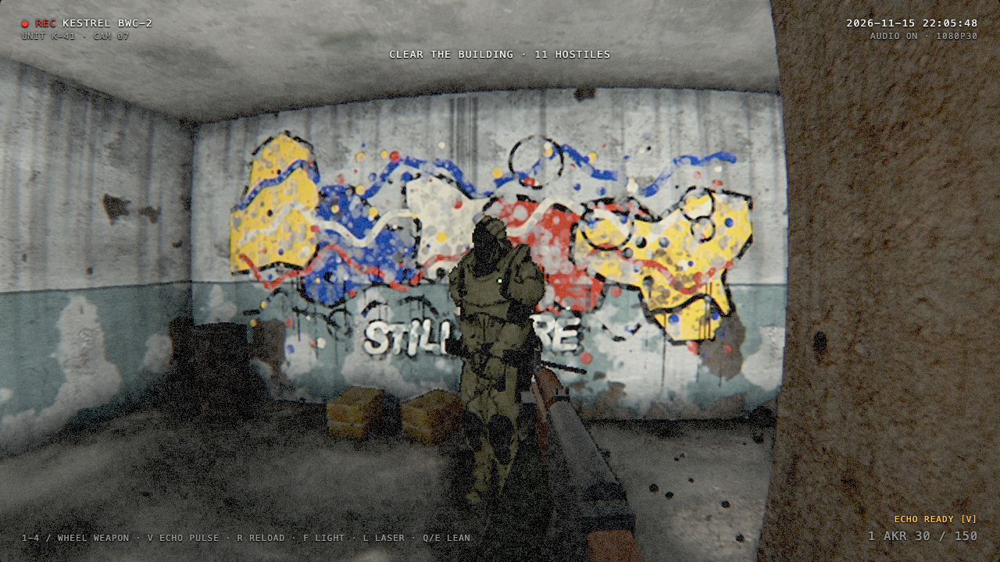

# CONCRETE ECHO

A body-camera style shooter that runs in the browser. You clear a two-storey derelict building of 11 armed hostiles, seen through a chest-mounted camera: fisheye lens, hard contrast, sensor grain, compressed-video colour and handheld shake.



## Features

- **Body camera look.** Barrel distortion, in-camera sharpening, 4:2:0 colour smear, crushed shadows, clipped highlights, auto exposure, motion blur and a recording overlay.
- **Real physics.** Crates, drums, chairs and the rest of the 65 photo-scanned props are Rapier rigid bodies. Bullets push them, go through soft cover and stop on concrete and steel. Hostiles fall as ragdolls that keep reacting to hits.
- **Detailed reloads.** The magazine is released and slides out of the well. An empty one falls, clatters and stays on the floor; a partly used one goes back to the pouch. A gloved hand seats the new magazine with a slap, and the bolt is racked after an empty reload.
- **Four weapons.** Rifle, pistol, pump shotgun loaded one shell at a time, and the Thumper, a launcher whose concussion charge throws bodies and furniture across the room.
- **Echo pulse.** Pings the building and shows hostiles through the walls for a few seconds, but tells the nearer ones where you are.

## Run it

Requires Node.js. There is no install step and there are no dependencies.

```bash
npm start
```

Open <http://localhost:5173> and press **DEPLOY**. Use `PORT=8080 npm start` to choose another port. Play in a desktop browser with WebGL 2 and a mouse; it has been tested in Chromium.

## Controls

| Input | Action |
| --- | --- |
| W A S D | Move |
| Mouse | Aim (the camera trails the weapon, as a body camera would) |
| Left click | Fire |
| Right click (hold) | Aim down the sights |
| 1 / 2 / 3 / 4, mouse wheel | Rifle / pistol / shotgun / Thumper |
| R | Reload |
| V | Echo pulse (14 second recharge) |
| Shift / C / Space | Sprint / crouch / jump |
| Q / E | Lean left / right |
| F | Weapon light |
| L | Laser on or off (the green dot is the only crosshair) |
| P | Performance mode |
| Esc | Pause |
| Enter | Redeploy after a run ends |

## How it plays

- There is no crosshair and almost no HUD.
- Hostiles see in a cone, hear gunfire and come looking for you.
- One shot to the head or two to the torso drops a hostile.
- Health comes back after five seconds without being hit.
- Bullets go through crates, cartons and chairs, losing damage each time. Walls, drums and concrete stop them.

## Project layout

| Path | Contents |
| --- | --- |
| `index.html` | Page, menu and camera overlay |
| `src/main.js` | Boot, input, game loop |
| `src/level.js` | Building, collision, lighting, navigation |
| `src/player.js` | Movement, camera, weapon handling, recoil, reloads |
| `src/weapons.js` | Weapon stats and models |
| `src/enemy.js` | Hostile AI, animation, ragdolls |
| `src/soldier.js` | Drives the soldier model from the ragdoll skeleton |
| `src/props.js` | Rigid-body props, bullet impulses, blasts |
| `src/fx.js` | Particles, decals, tracers, casings, dropped magazines |
| `src/post.js` | Post-processing and the body camera look |
| `src/audio.js` | Synthesized gunshots, impacts and room tone |
| `assets/` | Scanned textures, prop models, soldier model |
| `vendor/` | three.js r160 and Rapier 0.14 |

## Testing hooks

URL flags for checking the game without playing it: `?auto` starts immediately, `?noai` stops hostiles noticing you, `?q=low` starts in performance mode, and `?pos=x,y,z,yaw,pitch` moves the start point. The running game is available as `window.__game` in the console.

## Credits

- Textures and prop models: [Poly Haven](https://polyhaven.com), CC0.
- Soldier model: `Soldier.glb` from the [three.js examples](https://github.com/mrdoob/three.js/tree/r160/examples/models/gltf), a Mixamo character. Read Adobe's Mixamo terms before selling a build that includes it.
- [three.js](https://threejs.org) r160 (MIT) and [Rapier](https://rapier.rs) 0.14 (Apache 2.0).

The level, weapons, sounds and code are original to this project.
